  

  

  <a href="https://personal-portfolio-p-kappa.vercel.app/from-github">portfolio</a>
  &nbsp;·&nbsp;
  <a href="https://www.linkedin.com/in/atharvraotole/">linkedin</a>
  &nbsp;·&nbsp;
  <a href="mailto:atharv.raotole@stonybrook.edu">email</a>

---

### About

I build AI systems that have to work outside a notebook.

That usually means voice agents on real call flows, LLM pipelines with guardrails, and graph-backed tools for messy production data. Lately: supply-chain blast radius on FalkorDB, privacy-aware planning agents on Cloudflare, and LangGraph products used by educators.

Based in New York. MS in Applied Math & Statistics and Computer Science at Stony Brook (3.9 GPA).

Previously founding engineer at Pearl Social, and AI/ML roles at Answering Legal, Meltek, and Krevera.

---

  

  

 

  <picture>
    <source media="(prefers-color-scheme: dark)" srcset="https://raw.githubusercontent.com/AtharvRaotole/AtharvRaotole/output/github-contribution-grid-snake-dark.svg" />
    <source media="(prefers-color-scheme: light)" srcset="https://raw.githubusercontent.com/AtharvRaotole/AtharvRaotole/output/github-contribution-grid-snake.svg" />
    
  </picture>

