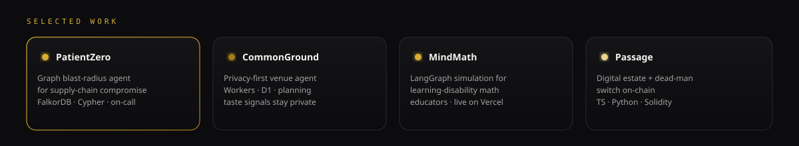

<!--
  Atharv Raotole — profile README
  Custom animated SVG system · neural lattice · voice signal
-->

  

  

 

  

  
  
  
  

---

### `>> transmission`

I design and ship **AI systems that act** — voice agents on real phone lines, graph-native incident tools, privacy-aware planners, and LangGraph products that survive contact with users.

Currently founding engineer at **Pearl Social**. Previously: Answering Legal · Meltek · Krevera · AutoBuddys.

---

  

  
  

  
  

  
  
  
  

---

### `>> stack`

  

  
  
  
  
  
  

---

### `>> telemetry`

  
  

  

---

### `>> contribution signal`

  <picture>
    <source media="(prefers-color-scheme: dark)" srcset="https://raw.githubusercontent.com/AtharvRaotole/AtharvRaotole/output/github-contribution-grid-snake-dark.svg" />
    <source media="(prefers-color-scheme: light)" srcset="https://raw.githubusercontent.com/AtharvRaotole/AtharvRaotole/output/github-contribution-grid-snake.svg" />
    
  </picture>

---

  

  <i>system nominal · open to hard problems in agents, voice, and graphs · transmit anytime</i>

